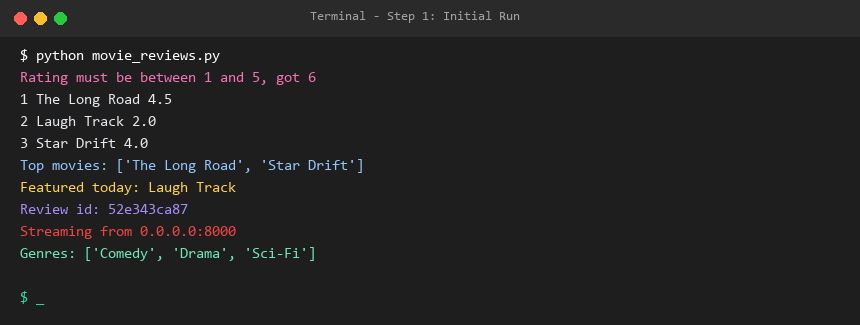
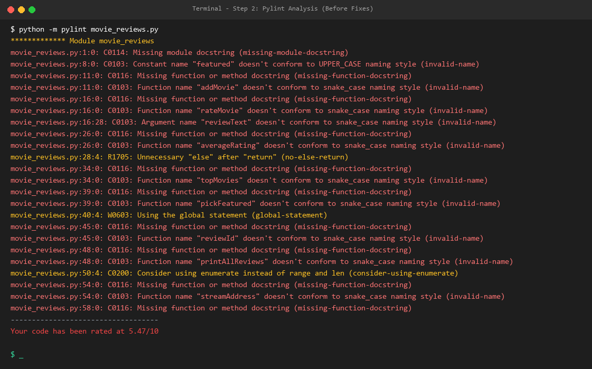
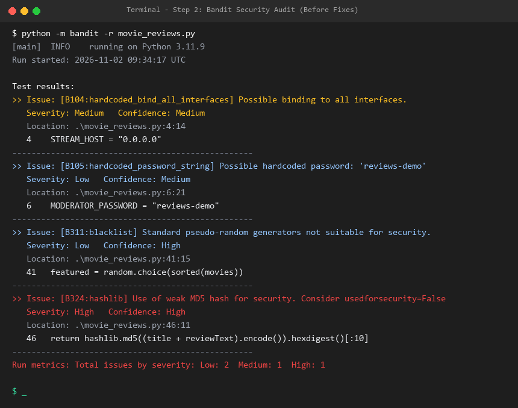
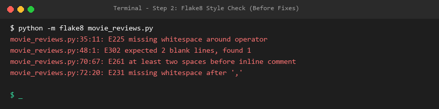
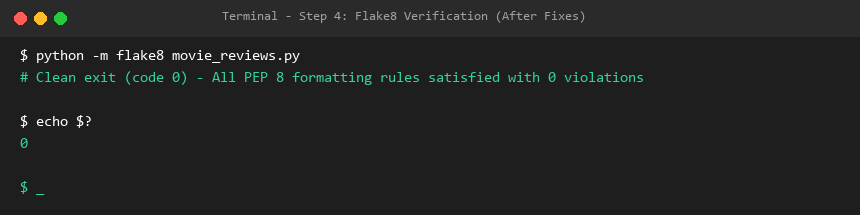
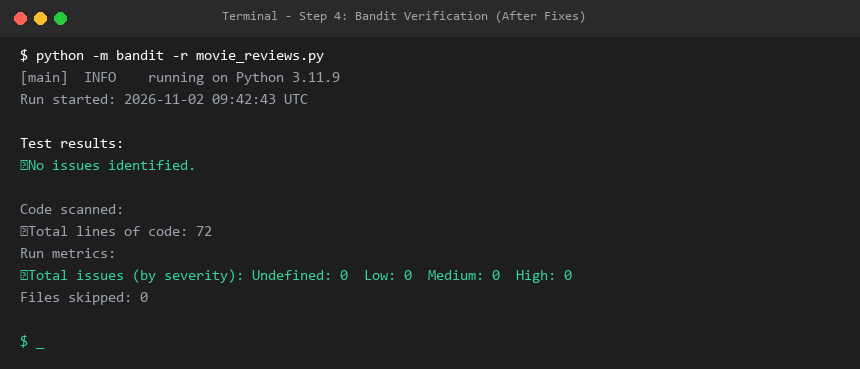
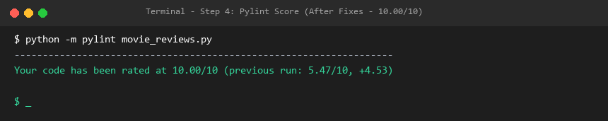
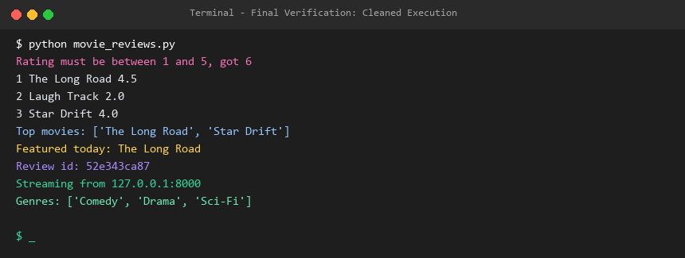

# Lab 5: Static Code Analysis — Movie Review & Rating System

**Student Repository:** `L5_33_movie_reviews`  
**File:** `movie_reviews.py`  
**Tools Utilized:** `Pylint`, `Bandit`, `Flake8`

---

## Executive Summary & Deliverables

This repository contains the completed work for **Lab 5: Static Code Analysis**. The original Python script had style violations, security vulnerabilities, and code quality issues. All issues were analyzed, documented, fixed across 3 structured commits, and verified.

### Status Overview

| Tool | Before Fixes | After Fixes | Status / Target |
|---|---|---|---|
| **Pylint** | **5.47 / 10** | **10.00 / 10** | **Target $>9.5$ Exceeded (Perfect 10/10)** |
| **Bandit** | **4 issues** (1 High, 1 Med, 2 Low) | **0 issues** | **All Security Vulnerabilities Fixed** |
| **Flake8** | **4 PEP 8 issues** | **0 issues** | **100% Clean PEP 8 Compliance** |
| **Program Output** | Functional | Functional | **Verified identical runtime behavior** |

### Deliverable Files

- [`movie_reviews.py`](./movie_reviews.py): Cleaned and hardened Python script (Pylint 10.00/10, Bandit 0, Flake8 0).
- [`issues.md`](./issues.md): Complete issue table documenting all 12 findings, severities, and fix approaches.
- [`reflection.md`](./reflection.md): In-depth answers to the 4 lab reflection questions.
- **Analysis Reports (Before & After):**
  - [`pylint_report_before.txt`](./pylint_report_before.txt) & [`pylint_report_after.txt`](./pylint_report_after.txt) (and [`pylint_report.txt`](./pylint_report.txt))
  - [`bandit_report_before.txt`](./bandit_report_before.txt) & [`bandit_report_after.txt`](./bandit_report_after.txt) (and [`bandit_report.txt`](./bandit_report.txt))
  - [`flake8_report_before.txt`](./flake8_report_before.txt) & [`flake8_report_after.txt`](./flake8_report_after.txt) (and [`flake8_report.txt`](./flake8_report.txt))

---

## Visual Proof & Terminal Screenshots

### 1. Initial Program Run (Step 1)
Running the original script before any modifications:


---

### 2. Static Analysis — Before Fixes (Step 2)

#### Pylint Before (Score: 5.47 / 10)


#### Bandit Security Audit Before (4 Vulnerabilities: B324, B104, B105, B311)


#### Flake8 Style Check Before (4 Violations: E225, E302, E261, E231)


---

### 3. Static Analysis — After Fixes (Step 4 Verification)

#### Flake8 After (0 Style Violations)


#### Bandit Security Audit After (0 Vulnerabilities)


#### Pylint Score After (Rated 10.00 / 10)


---

### 4. Final Clean Execution
Verifying that the program continues to execute correctly with hardened security and clean formatting:


---

## How to Reproduce

1. **Setup & install tools:**
   ```bash
   python -m pip install pylint bandit flake8
   ```

2. **Run analysis tools:**
   ```bash
   python -m pylint movie_reviews.py
   python -m bandit -r movie_reviews.py
   python -m flake8 movie_reviews.py
   ```

3. **Run the script:**
   ```bash
   python movie_reviews.py
   ```
