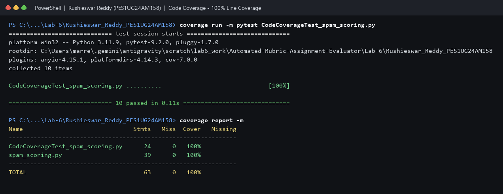
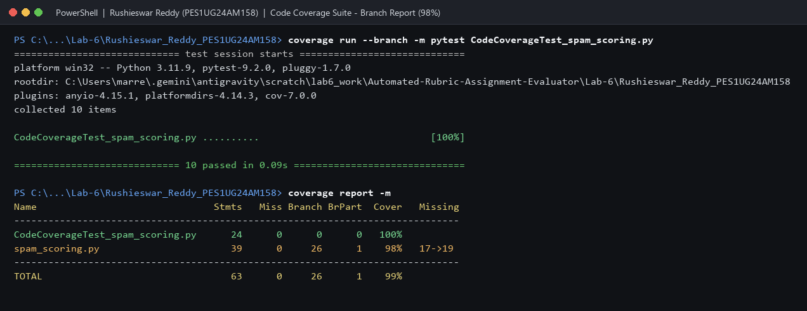
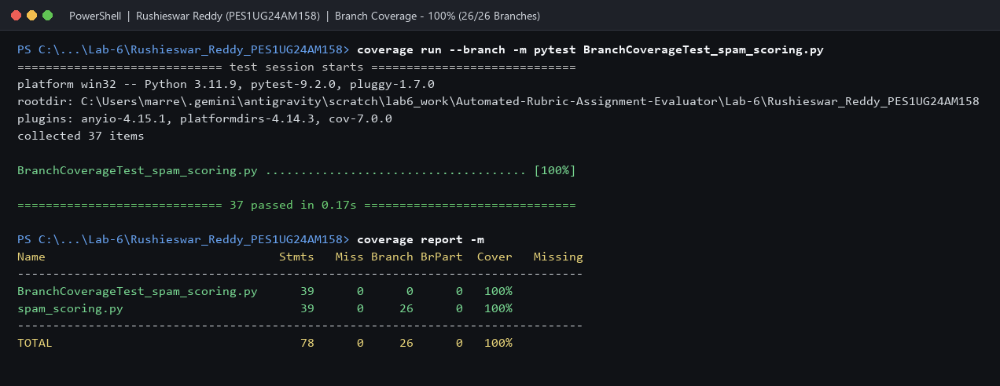
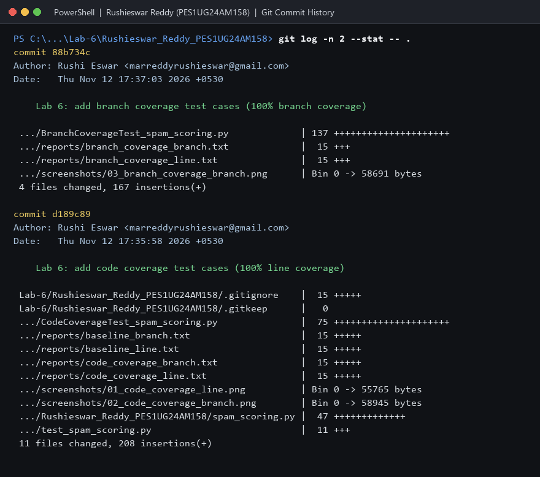

# Lab 6: Code and Branch Coverage Analysis (Spam Scoring Filter)

**Student:** Rushieswar Reddy (PES1UG24AM158)  
**Assigned Repository:** [`SETAPESU26/L6_L7_33_spam_scoring`](https://github.com/SETAPESU26/L6_L7_33_spam_scoring) (`lab6/`)  
**Course:** Software Engineering (UE24CS341A)  

---

## 1. Executive Summary

This submission completes **Lab 6: Code and Branch Coverage Analysis** for `spam_scoring.py` using Python's `coverage` library and `pytest`. Two separate test suites were created across distinct commits:

1. **Code Coverage Suite (`CodeCoverageTest_spam_scoring.py`)** — Targets statement (line) coverage, reaching **100%** (39/39 statements) on `spam_scoring.py`.
2. **Branch Coverage Suite (`BranchCoverageTest_spam_scoring.py`)** — Targets all decision outcomes, compound conditions, and boundary cases, reaching **100% line coverage** (39/39) and **100% branch coverage** (26/26 branches, 0 missed, 0 partial).

### Coverage Metrics Summary

| Test Phase | Test Suite File | Tests | Line Coverage (`spam_scoring.py`) | Branch Coverage (`spam_scoring.py`) | Missing / Partial |
|---|---|---:|---|---|---|
| **Starter Baseline** | `test_spam_scoring.py` | 2 | **41%** (16/39 stmts) | **38%** (26 branches, 7 partial) | Lines `8, 10, 12, 14, 16-18, 24, 26, 31-35, 39-47` |
| **Code Coverage Target** | `CodeCoverageTest_spam_scoring.py` | 10 | **100%** (39/39 stmts) | **98%** (26 branches, 1 partial) | Branch `17->19` |
| **Branch Coverage Target** | `BranchCoverageTest_spam_scoring.py` | 37 | **100%** (39/39 stmts) | **100%** (26/26 branches, 0 partial) | None (`0` missing) |

---

## 2. Line Coverage vs. Branch Coverage Analysis

### Why 100% Line Coverage Is Not Enough
Running `CodeCoverageTest_spam_scoring.py` executes every line of `spam_scoring.py` at least once (**100% line coverage**). However, running the exact same test suite with `coverage run --branch` reveals **98% branch coverage** with partial branch `17->19`:
- In `score_message(text, sender_known, link_count)`, lines 15–18 read:
  ```python
  if sender_known:
      score -= 3
      if score < 0:
          score = 0
  ```
- Passing a low-scoring message from a known sender (e.g., `score_message("hello", True, 1)`) executes lines 15, 16, 17, and 18 because `1 - 3 = -2 < 0`.
- Because every line ran, line coverage reports **100%** — even though the **False** path of `if score < 0:` (`17->19`, where a known sender's score stays `>= 0` after deducting `3`) was never tested.

### Achieving 100% Branch Coverage
`BranchCoverageTest_spam_scoring.py` exercises every decision and boundary in `spam_scoring.py` (26/26 branches, 0 partial):
1. **`score_message(text, sender_known, link_count)`**:
   - Empty string `""` (zero iterations of `for word in text.split():`, `6->11`).
   - All 5 `SPAM_WORDS` (`"free"`, `"winner"`, `"prize"`, `"urgent"`, `"cash"`), mixed casing, and stripped punctuation (`"!.,"`).
   - Compound condition `word.isupper() and len(word) > 3`: uppercase `len <= 3` (`"BUY NOW OK"`), mixed-case `len > 3` (`"Offer Deal"`), and uppercase `len >= 4` (`"SALE OFFER"`).
   - Link count thresholds: `0` (no bonus), `1` and `3` (`> 0` and `<= 3`, `+1`), `4` (`> 3`, `+4`).
   - Known sender clamping (`score < 3` -> `0`, `17->18`), exact boundary `score == 3` (`3 - 3 = 0`, `17->19`), positive remainder (`score > 3`, `17->19`), and unknown sender (`15->19`).
2. **`classify(score)`**:
   - Threshold boundaries: `0` and `3` (`"clean"`), `4` and `7` (`"suspicious"`), `8` and `12` (`"spam"`).
3. **`filter_inbox(messages)`**:
   - Empty inbox `[]` (loop runs 0 times, `32->35`) and mixed inbox spanning `"spam"`, `"suspicious"`, and `"clean"`.
4. **`inbox_status(counts)`**:
   - Empty inbox (`total == 0` -> `"empty"`).
   - Exact ratio boundaries: `0.0` and `0.2` (`"healthy"`, since `> 0.2` is strict), `0.25` and `0.5` (`"noisy"`, since `> 0.5` is strict), `0.6` and `1.0` (`"flooded"`).

---

## 3. Directory Contents

| Path | Description |
|---|---|
| `spam_scoring.py` | Application module under test (unchanged from `L6_L7_33_spam_scoring/lab6/`) |
| `test_spam_scoring.py` | Starter test file (used for the 41% line / 38% branch baseline) |
| `CodeCoverageTest_spam_scoring.py` | Deliverable 2: Test suite achieving **100% line coverage** |
| `BranchCoverageTest_spam_scoring.py` | Deliverable 3: Test suite achieving **100% branch coverage** |
| `reports/` | Saved text outputs for baseline, code coverage, and branch coverage runs |
| `screenshots/` | Deliverable 1: Terminal screenshots (`>= 90%` coverage runs and git commit log) |
| `screenshots/01_code_coverage_line.png` | `CodeCoverageTest_spam_scoring.py` line coverage report (100%) |
| `screenshots/02_code_coverage_branch.png` | `CodeCoverageTest_spam_scoring.py` branch coverage report (98%, partial `17->19`) |
| `screenshots/03_branch_coverage_branch.png` | `BranchCoverageTest_spam_scoring.py` branch coverage report (100%, 26/26 branches) |
| `screenshots/04_git_log.png` | Git commit history showing separate commits for code coverage and branch coverage |

---

## 4. Visual Proof (Terminal Screenshots)

### Code Coverage Test Suite (100% Line Coverage)


### Code Coverage Test Suite with `--branch` (98%, Missing `17->19`)


### Branch Coverage Test Suite (100% Branch Coverage — 26/26 Branches)


### Git Commit Log


---

## 5. Reproduction Commands

```bash
pip install coverage pytest

# 1. Code coverage test suite (100% line coverage, 98% branch coverage)
coverage run -m pytest CodeCoverageTest_spam_scoring.py
coverage report -m
coverage run --branch -m pytest CodeCoverageTest_spam_scoring.py
coverage report -m

# 2. Branch coverage test suite (100% line & 100% branch coverage)
coverage run --branch -m pytest BranchCoverageTest_spam_scoring.py
coverage report -m
```

**Environment:** Python 3.11.9, coverage 7.17.0, pytest 9.2.0 on Windows 11.
