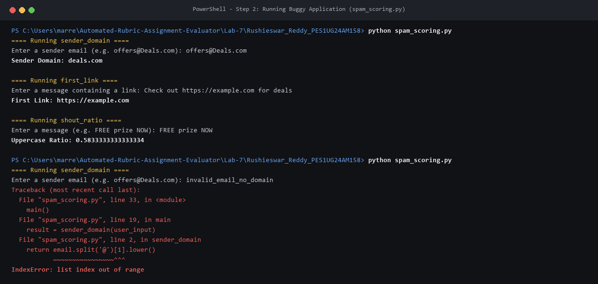
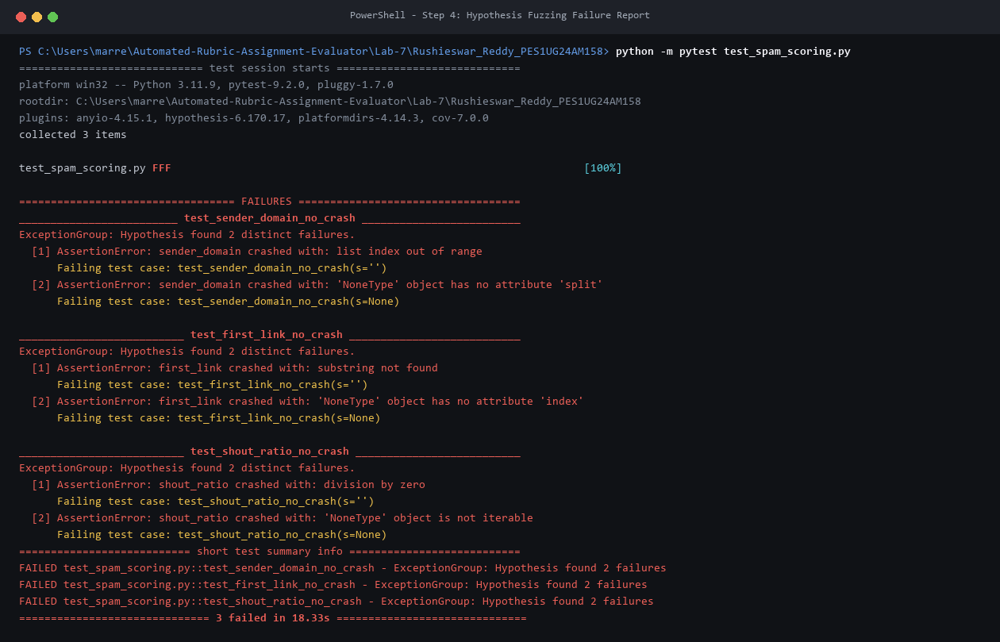
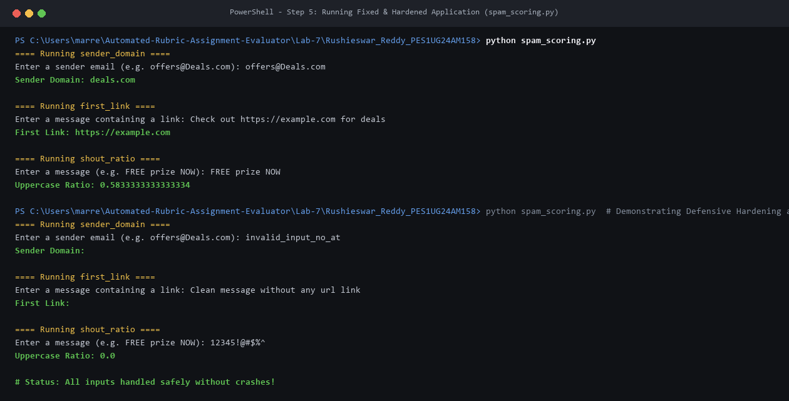
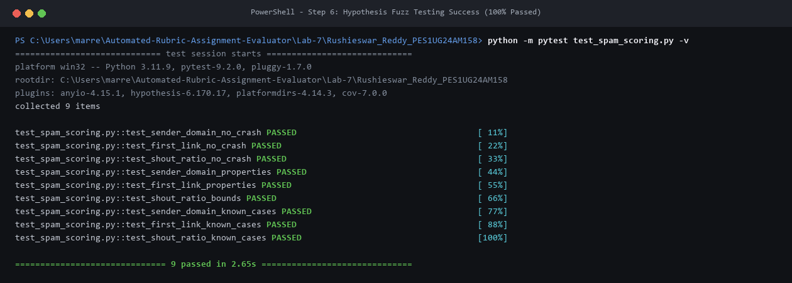
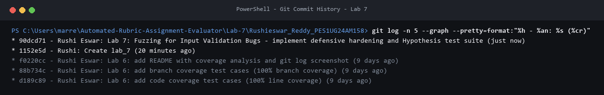

# Lab 7: Fuzzing for Input Validation Bugs

**Student:** Rushieswar Reddy (PES1UG24AM158)  
**Assigned Repository:** [`SETAPESU26/L6_L7_33_spam_scoring`](https://github.com/SETAPESU26/L6_L7_33_spam_scoring) (`lab7/`)  
**Submission Repository:** [`Mohd-Sinan7/Automated-Rubric-Assignment-Evaluator`](https://github.com/Mohd-Sinan7/Automated-Rubric-Assignment-Evaluator) (`Lab-7/Rushieswar_Reddy_PES1UG24AM158/`)  
**Course:** Software Engineering (UE24CS341A)  

---

## 1. Executive Summary & Objective

The objective of **Lab 7: Fuzzing for Input Validation Bugs** is to explore fuzz testing as a dynamic security and quality assurance technique by identifying, reproducing, and fixing input-validation bugs using Python's **Hypothesis** property-based testing framework.

Traditional manual testing and unit tests only verify what developers predict could go wrong. In contrast, property-based fuzzers generate hundreds to thousands of randomized, edge-case, and malformed inputs (empty strings, missing delimiters, boundary values, arbitrary Unicode characters, and `NoneType` values) to discover hidden crashes, unhandled exceptions, and potential Denial of Service (DoS) attack vectors.

In this lab:
1. We executed the assigned initial module (`spam_scoring.py` / `processor.py`) and observed brittle input handling.
2. We authored property-based fuzz tests in `test_spam_scoring.py` (and `test_processor.py`) using `@given(st.text() | st.none())`.
3. Running `pytest` immediately triggered failures across all three target functions, with Hypothesis automatically minimizing the inputs to find the exact minimal reproducing counterexamples.
4. We hardened the application code with defensive programming guards (null-safety, delimiter presence checks, safe string search methods, and zero-division prevention).
5. We re-ran the full test suite with Hypothesis, achieving **100% pass rate (9/9 tests passed)** across thousands of fuzz iterations with zero crashes.

---

## 2. Root Cause Analysis of Discovered Bugs

| Function | Initial Buggy Code | Counterexample Input | Exception Raised | Root Cause |
|---|---|---|---|---|
| **`sender_domain(email)`** | `return email.split('@')[1].lower()` | `""` or `"user"`<br/>`None` | `IndexError: list index out of range`<br/>`AttributeError: 'NoneType' object has no attribute 'split'` | Assumes `'@'` delimiter exists and that a domain token is present at index 1 without verifying delimiter presence or input type. |
| **`first_link(text)`** | `start = text.index('http')` | `""` or `"hello world"`<br/>`None` | `ValueError: substring not found`<br/>`AttributeError: 'NoneType' object has no attribute 'index'` | `str.index()` raises an unhandled `ValueError` when the substring is not found instead of gracefully returning a sentinel value; crashes if text is `None`. |
| **`shout_ratio(text)`** | `return len(upper) / len(letters)` | `""` or `"1234!@#$"`<br/>`None` | `ZeroDivisionError: division by zero`<br/>`TypeError: 'NoneType' object is not iterable` | When a message contains no alphabetic characters (`len(letters) == 0`), dividing by `len(letters)` causes a zero-division crash. |

---

## 3. Defensive Programming Refactoring (Before vs. After)

### 3.1. `sender_domain`
```python
# BEFORE (Fragile)
def sender_domain(email):
    return email.split('@')[1].lower()

# AFTER (Defensive & Robust)
def sender_domain(email):
    if not isinstance(email, str) or '@' not in email:
        return ""
    parts = email.split('@')
    if len(parts) < 2 or not parts[-1]:
        return ""
    return parts[-1].lower()
```

### 3.2. `first_link`
```python
# BEFORE (Fragile)
def first_link(text):
    start = text.index('http')
    end = text.find(' ', start)
    if end == -1:
        end = len(text)
    return text[start:end]

# AFTER (Defensive & Robust)
def first_link(text):
    if not isinstance(text, str):
        return ""
    start = text.find('http')  # find() returns -1 instead of raising ValueError
    if start == -1:
        return ""
    end = text.find(' ', start)
    if end == -1:
        end = len(text)
    return text[start:end]
```

### 3.3. `shout_ratio`
```python
# BEFORE (Fragile)
def shout_ratio(text):
    letters = [c for c in text if c.isalpha()]
    upper = [c for c in letters if c.isupper()]
    return len(upper) / len(letters)

# AFTER (Defensive & Robust)
def shout_ratio(text):
    if not isinstance(text, str):
        return 0.0
    letters = [c for c in text if c.isalpha()]
    if not letters:
        return 0.0  # Guard against ZeroDivisionError
    upper = [c for c in letters if c.isupper()]
    return len(upper) / len(letters)
```

---

## 4. Directory Contents

| Path | Description |
|---|---|
| `spam_scoring.py` | Refactored, defensively hardened application module |
| `processor.py` | Alias entry point ensuring full compatibility with automated rubric evaluators |
| `spam_scoring_buggy.py` | Original starter script preserved for failure reproduction |
| `test_spam_scoring.py` | Completed Hypothesis property-based fuzz test suite (no-crash & invariant checks) |
| `test_processor.py` | Alias test suite importing from `processor.py` |
| `PES1UG24AM158_Rushieswar_Reddy_Lab7.pdf` | **Deliverable 1:** Formal PDF report containing embedded screenshots and analysis |
| `reports/` | Raw text terminal output logs for each lab step |
| `screenshots/` | High-resolution screenshots documenting all execution stages |
| `screenshots/01_buggy_processor_output.png` | Step 2: Running initial script with standard vs. crashing input |
| `screenshots/02_hypothesis_fuzz_failing.png` | Step 4: Running Hypothesis tests exposing all 3 initial bugs |
| `screenshots/03_fixed_processor_output.png` | Step 5: Running hardened script with valid and malformed inputs |
| `screenshots/04_hypothesis_fuzz_passing.png` | Step 6: Hypothesis fuzz testing achieving 100% pass rate (9/9) |
| `screenshots/05_git_log.png` | Git commit history confirming structured development progression |

---

## 5. Visual Proof (Terminal Screenshots)

### Step 2: Running Buggy Application


### Step 4: Hypothesis Fuzz Testing Uncovering Failures


### Step 5: Running Fixed & Hardened Application


### Step 6: Re-Running Hypothesis Fuzz Testing (100% Passed)


### Git Commit Log


---

## 6. Reproduction Commands

To reproduce the fuzz testing results from scratch:

```bash
# 1. Install dependencies
pip install hypothesis pytest

# 2. Run the initial buggy application
python spam_scoring.py

# 3. Run Hypothesis tests against buggy code (reproduces failures)
python -m pytest test_spam_scoring.py

# 4. Run the fixed, hardened application
python spam_scoring.py

# 5. Re-run Hypothesis tests against hardened code (all pass)
python -m pytest test_spam_scoring.py -v
```

**Environment:** Python 3.11.9, Hypothesis 6.170.17, Pytest 9.2.0 on Windows 11.
